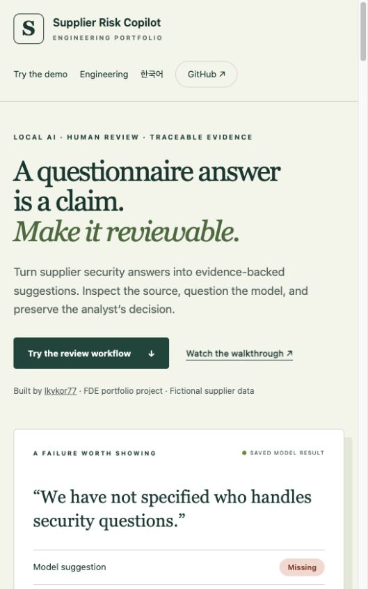
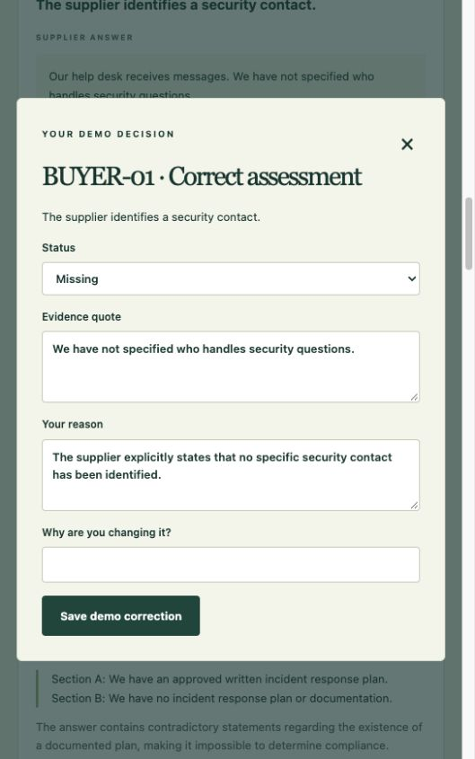
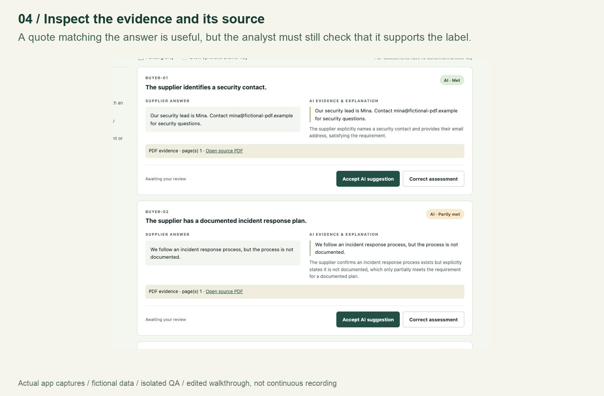
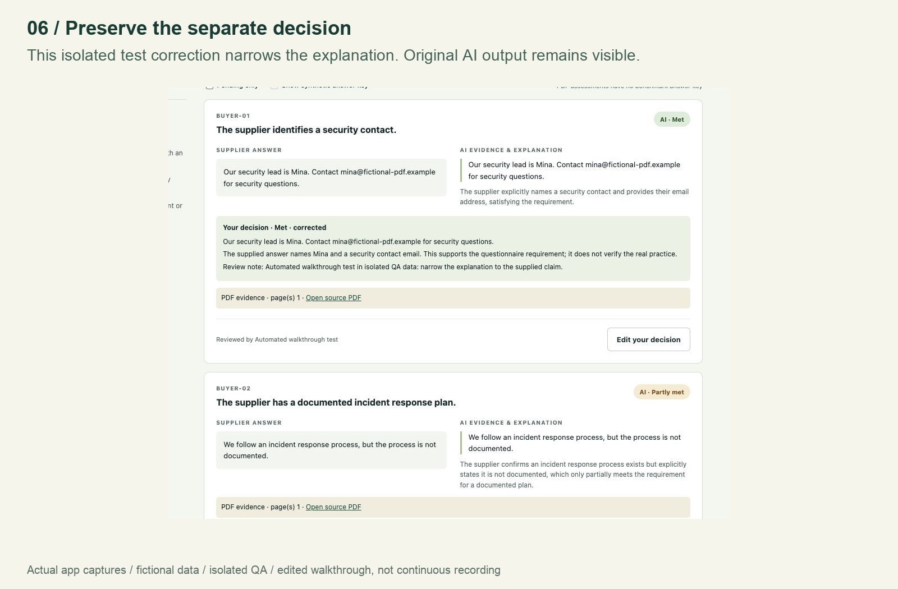
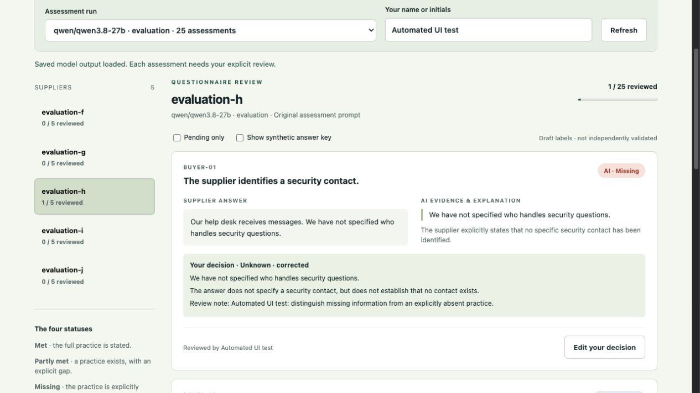

# Supplier Risk AI Copilot

**A questionnaire answer is a claim. Make it reviewable.**

An FDE portfolio project that helps a supplier-security analyst turn questionnaire answers into evidence-backed suggestions. Inspect the supplier's answer and supporting quote, check the source page, then accept or correct the assessment. The original AI result and the reviewer’s decision remain separate.

**[Try the public interactive demo](https://lkykor77.github.io/supplier_risk_AI_copilot/)** · [Watch the 90-second walkthrough](https://lkykor77.github.io/supplier_risk_AI_copilot/#walkthrough) · [Engineering case study](docs/portfolio-case-study.md) · [한국어 개요](docs/overview-ko.md)

The public website uses fictional supplier answers and saved Qwen results. Visitors can explore five example suppliers, inspect the evidence, and try corrections in their browser. The full application runs locally with LM Studio and handles selectable-text, scanned, and mixed PDFs; selected Obsidian notes are optional.

## Why this project matters

### Problem statement

Before onboarding a supplier, information-security teams need evidence that its controls and policies meet the buyer’s security requirements. Those requirements may be informed by ISO/IEC 27001, NIST CSF, contracts, and regulations applicable to the organization and supplier relationship. NIST’s [supply-chain guide](https://csrc.nist.gov/pubs/sp/1305/final) describes defining and communicating supplier requirements; [ISO/IEC 27001](https://www.iso.org/standard/27001) provides a risk-based information-security management context.

The proposed user is a security analyst who receives evidence in inconsistent formats: standard questionnaires, spreadsheets, PDFs, or scanned documents with supplier-defined layouts. The analyst must locate each answer, compare it with the buyer’s requirements, identify contradictions and missing evidence, and document the assessment for a human decision.

### Pain points

- **Inconsistent submissions:** different wording, layouts, tables and scans make relevant answers hard to locate.
- **Repetitive interpretation:** analysts repeatedly compare similar claims with the same security expectations.
- **Ambiguous evidence:** a vague answer is not proof that a control exists or that it is absent; keyword matching can miss that distinction.
- **Weak traceability:** copying answers and decisions between documents makes source references and later corrections harder to follow.
- **Unclear prioritization:** a count of unmet controls can hide an important failure or an unresolved evidence gap.

Manual review time is a discovery question. There is **no verified “average X hours” or measured time-saving claim** for this project. The planned user study will measure minutes per questionnaire, corrections, evidence follow-ups and reviewer effort.

### How the AI tool helps

The app extracts PDF text and local OCR, lets an analyst confirm question-to-answer mappings and source pages, and asks a local open-weight model to propose structured assessments against the configured buyer requirements. Each suggestion includes a quote and reason. People then accept or correct the results, with original AI output preserved separately from their decisions.

After every requirement has a human decision, the tool calculates a **weighted questionnaire risk indicator**. It separates confirmed gaps from unknown evidence and distinguishes normal suppliers from critical suppliers needing enhanced review. It supports prioritizing follow-up; it does not automatically approve suppliers.

### Intended outcome and evidence today

The intended outcome is a more consistent, traceable review record: checked source evidence, inspectable AI suggestions, human decisions, and a transparent summary of weighted gaps. Reducing repetitive review effort is a hypothesis to validate with users, not a proven result.

Today, the prototype implements **five fictional buyer requirements**, a working PDF-to-review workflow, synthetic evaluations, and human-reviewed gap scoring. **Complete ISO 27001/NIST control mappings, regulatory assessment, direct Excel import, and real-supplier validation are planned.** It does not certify compliance or verify that supplier claims are true.

## Features at a glance

| Feature | Current behavior |
| --- | --- |
| PDF and scanned-PDF reading | Local PDFKit extraction and on-device OCR; selectable-text, scanned and mixed PDFs; analyst-confirmed mappings and source-page references |
| Local open-weight AI | Qwen through LM Studio on a loopback endpoint; structured JSON and evidence-quote checks; no cloud fallback on the local path |
| Obsidian rules and memory | Optional allowlisted AI rules/knowledge and app-owned project memory; personal notes stay private; frozen evaluation excludes vault context |
| Human review | Accept or correct labels, quotes and explanations; retain original AI output and decision history |
| Weighted questionnaire risk | Fixed status factors and equal control weights; final human decisions only; unresolved evidence shown separately; normal/critical supplier classification and enhanced-review flags |
| Public interactive demo | Fictional answers and saved AI results; try corrections and scoring without a model server; no public document uploads |
| Engineering evidence | Tests, frozen synthetic comparisons, failure analysis, setup guides, captioned walkthrough and English/Korean project overview |
| Future scope | Validated framework/regulatory mappings, Excel import, richer supplier risk scenarios and measured user outcomes |

## Data flow


AI suggestions never replace the human assessment. Page references, original results and reviewer corrections remain traceable. Optional Obsidian context is separate from the frozen evaluation.

## System design


The Python API serves the local review app. Swift/Node helpers extract PDFs; LM Studio hosts Qwen; local storage keeps source snapshots, human decisions and supplier-classification history. GitHub Pages serves only the copied fictional demo assets. See the [engineering case study](docs/portfolio-case-study.md) and [risk methodology](docs/risk-scoring.md).

### Project preview

**Explore a real saved model error.** The demo shows an unspecified security contact labeled `missing`, while the draft rubric expects `unknown`. Visitors can challenge the suggestion instead of seeing only successful examples.

<a href="https://lkykor77.github.io/supplier_risk_AI_copilot/">
  
</a>

**Inspect and correct the suggestion.** The public demo’s correction form lets visitors change the status, evidence quote, explanation, and change note. Demo decisions stay in the browser session; the website makes no live inference requests or document uploads.



**Trace PDF evidence back to its source.** In the local app, the analyst checks extracted answers and page mappings before Qwen assesses them. These captures from the website’s walkthrough show fictional scan results with supporting quotes and source-page links.



**Preserve the analyst’s decision.** A clearly marked automated QA example narrows an explanation to what the supplied answer supports. The revised decision appears alongside the unchanged AI output, with a review note and source reference.



**Engineering evidence:** 47 app tests passed on the development Mac. In one frozen synthetic evaluation, local Qwen matched 24/25 draft labels, versus 23/25 for an earlier Gemini run and 8/25 for the keyword baseline. The small dataset and unvalidated draft labels do not establish real-world accuracy or general model superiority. See the [results and limitations](docs/local-integration-results.md).

## Review assessments in your browser

```sh
python3 review_app.py
```

Open **http://127.0.0.1:8501**. The [analyst review guide](docs/analyst-review.md) explains how to accept or correct assessments, validate quotes, and save decisions separately from the AI output. It works from saved reports without running a model. Your review history stays local.



## Upload supplier questionnaires as PDF

The [PDF intake guide](docs/pdf-intake.md) covers local uploads of text, scanned, and mixed PDFs. Check the extracted text, map answers to the five requirements with page references, then assess with LM Studio and review the proposed decisions. Originals and intake records stay local. No Google API call is used for this flow.

## Run the keyword exercise

The assessors and saved-report review use Python's standard library. PDF intake adds a macOS helper and a Node OCR dependency. It includes a keyword baseline, a Gemini assessor, and a local model assessor with optional Obsidian context. All suppliers and answers are fictional.

After cloning this repository, open a terminal in the project folder and run:

```sh
python3 baseline.py
```

You should see twenty-five assessments and a count of matches against the hand-written answer key. This is a toy exercise, not a meaningful performance benchmark.

Open `data/suppliers.json` in an editor. Notice how the third supplier explicitly denies having some practices. The deliberately naive keyword baseline still marks two denied practices as met. This gives the future AI version a concrete problem to improve on.

Two additional suppliers test frequency: `fictional-d` reviews access every two years (`partly_met`), while `fictional-e` reviews it "regularly" (`unknown`). They also include partial or vague answers about administrator authentication and backup restore testing. Their security contact and incident response answers are intentionally blank. The baseline currently matches 18 of 25 labels; this small development dataset is not a held-out evaluation.

## Initial scope

Next, read the [draft problem statement](docs/problem-statement.md) and [assessment guide](docs/assessment-guide.md). The guide explains the four statuses and includes your next exercise.

- One user: a supplier-security analyst.
- Input: structured answers in JSON, or locally uploaded PDFs with analyst-confirmed answer mapping.
- Output: a proposed status, an exact supporting quote when available, and a reason.
- Statuses: met, partly_met, missing, unknown.
- `missing` means explicit evidence that a required practice is absent; an unanswered question means `unknown`.
- Suggested statuses describe the supplied answers; they do not verify actual supplier practices or certify compliance.
- Human decisions are saved separately from immutable model output, with an audit history.

The five requirements are fictional buyer requirements, not official NIST or ISO controls. Next, document how these buyer requirements relate to NIST CSF 2.0 guidance, including the limits of each mapping. Some framework outcomes concern the buyer's own processes and cannot be assessed from supplier answers alone.

## Build milestones

1. Run this exercise and explain the two false-positive results.
2. Write a one-page problem statement and clarify the assessment rubric with a potential user.
3. Initial dataset complete: five buyer requirements and five fictional suppliers with rubric-based expected labels. Review these labels with a potential user before treating them as ground truth.
4. Add an AI assessor with structured results and validated evidence quotes.
5. Compare AI and keyword results on additional suppliers held out from prompt development. Track per-status errors, unsupported positive assessments, unknown handling, latency, and cost.
6. Local analyst review and PDF intake implemented; persist reviewer corrections separately.
7. Add reproducible setup, essential tests, GitHub CI, screenshots, user feedback, and a deployment guide.

Keep ISO mappings, MCP, website checks, NIS2 and CRA reporting for later.

The [frozen evaluation plan](docs/evaluation-plan.md) adds 25 new synthetic assessments using the unchanged prompt. The first run matched **23/25 AI labels versus 8/25 baseline labels**; see the [two errors and evaluation limits](docs/evaluation-results.md). Run it separately from the development examples:

```sh
python3 ai_assessor.py --dataset evaluation --all
```

## AI assessment preparation

### Local Qwen and Obsidian

The [local setup guide](docs/local-setup.md) connects LM Studio with an optional allowlist of Obsidian rules, knowledge and project memory:

```sh
python3 local_assessor.py --check-server
python3 local_assessor.py
python3 local_assessor.py --with-vault --save-memory
```

The [verified local integration results](docs/local-integration-results.md) record a 5/5 vault-enhanced smoke test and a separate 24/25 frozen evaluation result (Gemini: 23/25; keyword baseline: 8/25). These small synthetic runs do not establish general accuracy.

Use `python3 local_assessor.py --dataset evaluation --all` for the unchanged-prompt comparison. Vault-enhanced runs are separate experiments. Local inference has no cloud fallback. Personal notes and machine-specific config stay out of GitHub. Docker and oMLX are optional later choices, not required services.

`assessment.py` prepares model input without expected labels or keyword rules. It validates that results cover each requirement exactly once and quote only the corresponding supplier answer. Blank answers must be `unknown`. Quote matching checks that evidence exists; a person must still check that it supports the conclusion.

The Gemini connection is implemented in `ai_assessor.py`. Follow the [local Gemini setup guide](docs/gemini-setup.md):

```sh
python3 setup_key.py
python3 ai_assessor.py
```

The first run assesses one supplier; `python3 ai_assessor.py --all` compares all five. On October 13, 2026, a complete live run with `gemini-3.5-flash-lite` matched 25/25 development labels, versus 18/25 for the keyword baseline. All 16 nonempty quotes passed verbatim checks. These examples informed the prompt; this is not a held-out accuracy estimate. See the [evaluation results and limitations](docs/development-evaluation.md) and [saved run](reports/development-run-2026-10-13.json). Run the evidence-validation and mocked integration tests without an API account or network access:

```sh
python3 -m unittest discover -s tests -v
```

## Portfolio evidence to collect

- Discovery notes without confidential information.
- Manual review time versus assisted review time, including corrections.
- Evaluation method, results, limitations, and failure examples.
- Architecture, engineering tradeoffs, and what changed after user feedback.
- English README and demo; optionally a short Korean overview.

This repository contains a keyword baseline, Gemini and local assessors, and fictional data. ISO 27001 / NIST CSF mappings are planned; they are not implemented yet. The Gemini assessor makes cloud API calls; the local assessor calls only a loopback model server. Dry runs make no inference requests. Never commit credentials or confidential supplier data.

Reference: https://csrc.nist.gov/pubs/sp/1305/final
