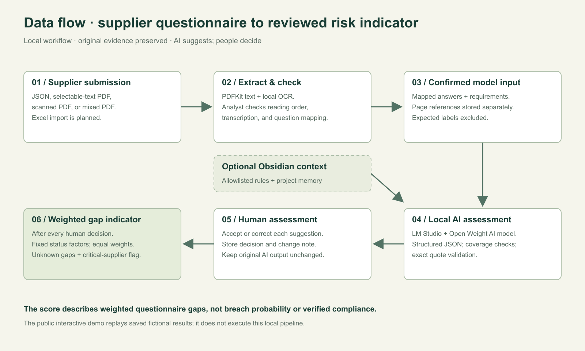
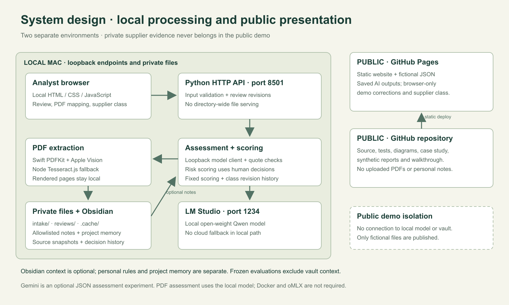
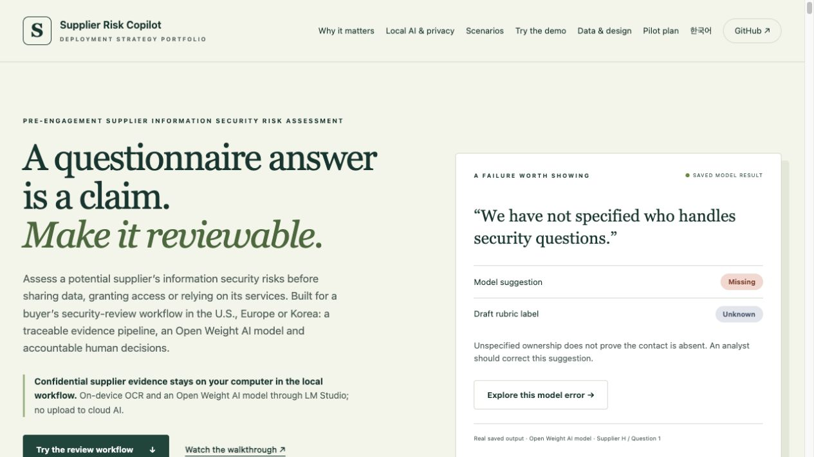
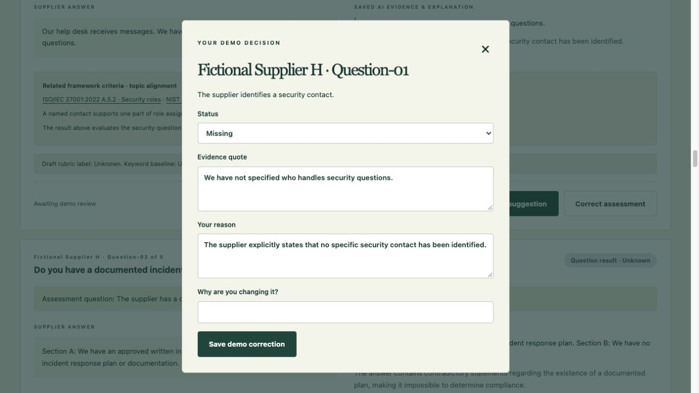
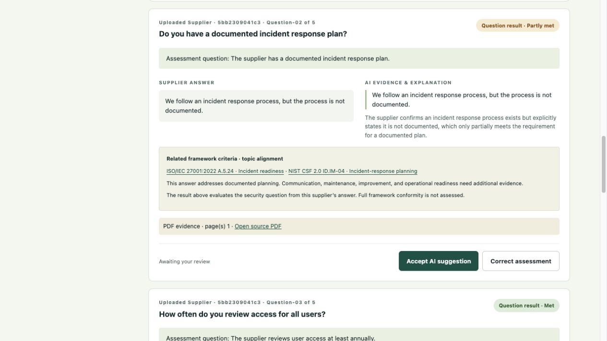
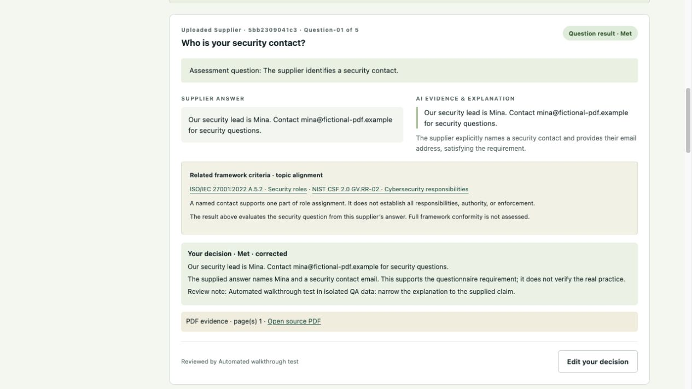
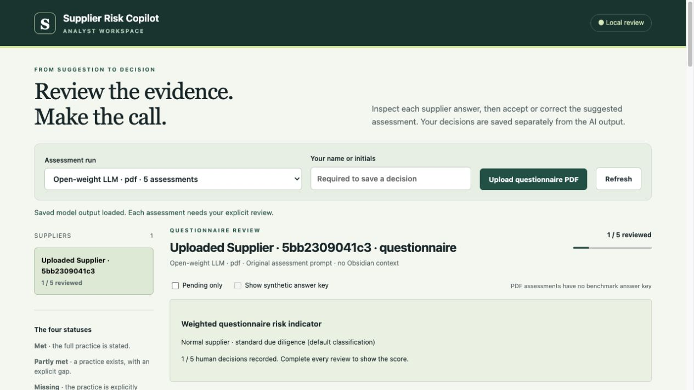
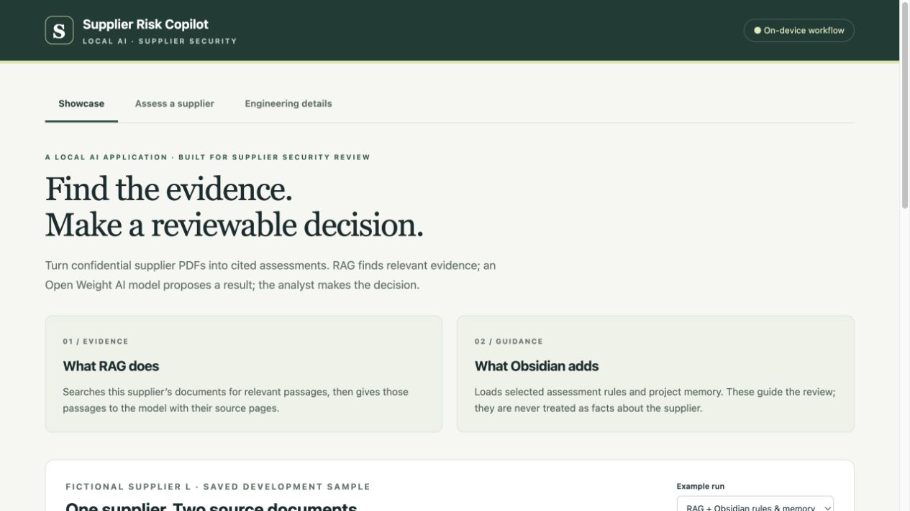
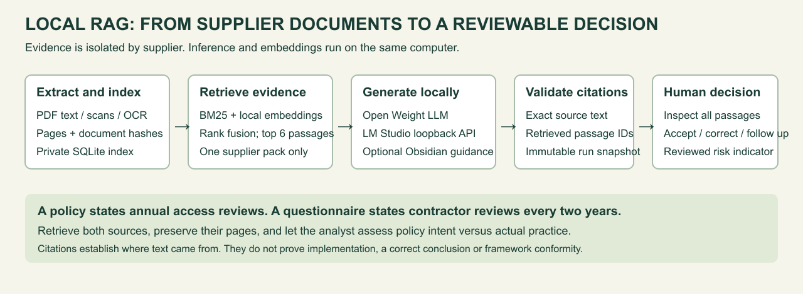
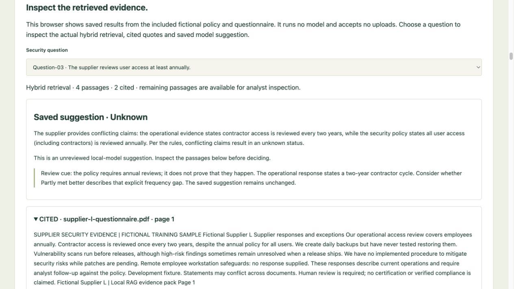

# Supplier Risk AI Copilot

**A questionnaire answer is a claim. Make it reviewable.**

A **Deployment Strategist portfolio project** that addresses **pre-engagement information security risk assessment of potential suppliers** through an operational data pipeline and a working review application. It connects customer workflow strategy with Python/JavaScript development, local inference through an **Open Weight AI model**, and human decisions supported by traceable evidence.

**[Try the clean RAG showcase](https://lkykor77.github.io/supplier_risk_AI_copilot/#rag)** · [See the local workflow](https://lkykor77.github.io/supplier_risk_AI_copilot/#walkthrough) · [Engineering case study](docs/portfolio-case-study.md) · [한국어 개요](docs/overview-ko.md)

The public demo uses fictional suppliers and saved AI results. The full application processes JSON, selectable-text PDFs and scanned PDFs locally, integrates an Open Weight AI model through **LM Studio**, uses **local RAG** to find page-cited evidence across supplier documents, and can use selected **Obsidian rules, knowledge and project memory**.

**Why local AI? Supplier submissions can contain confidential security policies, infrastructure details and incident procedures. The local assessment workflow keeps documents, extracted answers, selected Obsidian context and review records on the user’s computer; it does not upload them to a cloud AI provider.** A lightweight **custom Python AI harness** manages the model requests and validation around LM Studio. [Privacy boundary and harness design](docs/local-privacy-and-ai-harness.md).

## What this portfolio demonstrates

| Deployment capability | Concrete project evidence |
| --- | --- |
| Understand the business decision | Supplier information security risk problem statement, analyst pain points, stakeholder handoffs and a [proposed customer pilot](docs/customer-deployment-plan.md) |
| Turn fragmented data into a pipeline | Document extraction/OCR → checked answers → requirements → structured assessments → human decisions → risk summary, with source references |
| Build and analyze code | Python API, JavaScript application, Swift/Node PDF helpers, validation, revision checks, failure analysis and 64 automated tests |
| Build a local AI harness | Custom Python orchestration of prompts, allowlisted Obsidian context, loopback LM Studio requests, structured-output parsing and evidence validation |
| Make a deployment choice for confidential evidence | On-device PDF/OCR and Open Weight AI model inference; local records; no document upload to a cloud AI service or cloud fallback in the local workflow |
| Exercise product judgment | Explicit PDF confirmation, visible model errors, separate reviewer decisions, unknown-evidence handling and critical-supplier follow-up |
| Communicate and support adoption | Interactive demo, local-app walkthrough, architecture diagrams, English/Korean overview and a proposed training/measurement plan |

This is an independent prototype with verified technical evidence and a proposed customer-validation plan. See the [Deployment Strategist portfolio narrative](docs/deployment-strategy-portfolio.md) and [engineering case study](docs/portfolio-case-study.md).

## Why this project matters

### Problem statement

Before working with a potential supplier—sharing information, granting system access, or depending on its services—a company needs to assess the information security risks that relationship could introduce. This project supports that pre-engagement supplier risk assessment for companies operating in the **U.S., Europe and Korea**. 

The security team reviews whether the supplier’s stated controls and policies satisfy the criteria covered by the organization’s security questions, and which gaps require evidence, remediation or escalation. Those requirements may be informed by ISO/IEC 27001, NIST CSF, contracts, and regulations applicable to the organization and supplier relationship. NIST’s [supply-chain guide](https://csrc.nist.gov/pubs/sp/1305/final) describes defining and communicating supplier requirements; [ISO/IEC 27001](https://www.iso.org/standard/27001) provides a risk-based information-security management context.

The operational question is **what information security risk would this supplier relationship introduce, what evidence supports the assessment, and what must be resolved before proceeding?** The buyer’s risk owner decides whether to proceed, require remediation, accept an exception or decline the relationship. Geography alone does not determine risk or criticality; assessment depth depends on data sensitivity, access, service dependency and applicable obligations. 

Security analysts, procurement teams and risk owners need a shared, explainable review record. The proposed analyst receives evidence in inconsistent formats: standard questionnaires, spreadsheets, PDFs, or scanned documents with supplier-defined layouts. The analyst must locate each answer, compare it with the assessment criteria, identify contradictions and missing evidence, and document the assessment for a human decision.

### Pain points

- **Inconsistent submissions:** different wording, layouts, tables and scans make relevant answers hard to locate.
- **Repetitive interpretation:** analysts repeatedly compare similar claims with the same security expectations.
- **Ambiguous evidence:** a vague answer is not proof that a control exists or that it is absent; keyword matching can miss that distinction.
- **Weak traceability:** copying answers and decisions between documents makes source references and later corrections harder to follow.
- **Unclear prioritization:** a count of unmet controls can hide an important failure or an unresolved evidence gap.

Manual review time is a discovery question. The planned user study will measure minutes per questionnaire, corrections, evidence follow-ups and reviewer effort.

### How the AI tool helps

The app extracts PDF text and local OCR, lets an analyst confirm question-to-answer mappings and source pages, and asks a local Open Weight AI model to propose structured assessments against the configured security questions. Each suggestion includes a quote and reason. People then accept or correct the results, with original AI output preserved separately from their decisions.

After every requirement has a human decision, the tool calculates a **weighted questionnaire risk indicator**. It separates confirmed gaps from unknown evidence and distinguishes normal suppliers from critical suppliers needing enhanced review. It supports prioritizing follow-up; it does not automatically approve suppliers.

### Intended outcome and evidence today

The intended outcome is a more consistent, traceable review record: checked source evidence, inspectable AI suggestions, human decisions, and a transparent summary of weighted gaps. Reducing repetitive review effort is a hypothesis to validate with users, not a proven result.

Today, the prototype implements **20 questions for local PDF intake and five frozen benchmark questions**, a working PDF-to-review workflow, synthetic evaluations, and human-reviewed gap scoring. **The demo now shows [illustrative ISO 27001/NIST topic references](docs/framework-references.md) for the original five questions and HECVAT topic references for the added questions. Complete validated control mappings, regulatory assessment, direct Excel import, and real-supplier validation remain planned.** It does not certify compliance or verify that supplier claims are true.

## Confidential evidence: why use a local Open Weight AI model?

Confidential supplier documents should not be sent to an unapproved cloud AI service. Local inference was chosen to support that constraint, rather than requiring a reviewer to upload sensitive material to a model provider.

- **Keep the evidence local:** PDF extraction/OCR, prompts, model inference and saved decisions are processed on the user’s computer. Selected Obsidian rules and memory go only to the local model endpoint.
- **Control the inference environment:** choose the supported model, runtime and generation settings; retain prompt/data hashes and outputs for investigation and repeat evaluation. Model or runtime changes require validation.
- **Reduce cloud-service dependency:** once the model, runtime and OCR dependencies are installed, the local workflow needs no cloud inference API, account quota or automatic cloud fallback. LM Studio documents [offline operation](https://lmstudio.ai/docs/app/offline).
- **Avoid per-request cloud inference charges:** local requests use the user’s hardware. Compute, memory, electricity and setup still have costs; this is not a claim that local deployment is always cheaper or faster.

**Privacy boundary:** these statements describe the implemented local application workflow, not a guarantee about every program on the computer. Model/package downloads and updates use network access. Separately configured Obsidian/iCloud sync, backups, remote access, extensions or deliberate exports can transmit files outside the app. For confidential use, keep evidence and any sensitive vault context in approved local storage and review those settings. The public demo accepts no uploads and contains only fictional evidence. See [the documented boundary and code evidence](docs/local-privacy-and-ai-harness.md).

## What the custom AI harness does

The **AI harness** is the application code surrounding the model—not the model itself. Python prepares the question rubric and supplier answers, loads explicitly selected Obsidian context, calls LM Studio through a constrained loopback client, parses completed structured output and validates requirement coverage and exact quotes. The review application keeps saved AI suggestions separate from accountable human decisions and calculates the indicator only after complete review. This is a bounded assessment workflow, not an autonomous supplier-approval agent.

The implementation is inspectable in [local_assessor.py](local_assessor.py), [assessment.py](assessment.py), [vault_context.py](vault_context.py), [pdf_intake.py](pdf_intake.py) and [review_store.py](review_store.py). LM Studio hosts the model; the custom Python harness manages its use.

## Realistic fictional assessment scenarios

These contexts illustrate how a buyer could use the existing synthetic answers. They are not real customers, verified supplier evidence or additional AI evaluation runs.

| Potential supplier relationship | Exposure and evidence | Assessment and next action |
| --- | --- | --- |
| **U.S. company → customer-support SaaS (Supplier F)** | Customer contact records and support tickets; text questionnaire and requested supporting policy/test records | All five saved suggestions are met. Request the current incident plan, access-review record, administrator MFA evidence and latest restore-test report before relying on the claims. Five met answers do not establish acceptable overall risk. |
| **European company → managed IT provider (Supplier G)** | Privileged production access; questionnaire and requested scanned procedures | Contractor administrators are exempt from MFA; non-admin access is never reviewed; the incident process is undocumented. Request MFA enforcement, broader access reviews and a written plan; escalate unresolved gaps before privileged access is granted. |
| **Korean manufacturer → logistics platform (Supplier H)** | Shipment/customer contact data and dispatch dependency; mixed PDF with conflicting answers | Incident-plan and access-review claims contradict each other; nightly backups do not demonstrate restore testing. Request reconciled, dated evidence and restore-test records; correct the saved contact-label error to Unknown. |

The proposed document packs are scenario context; the public demo displays saved questionnaire answers and has no document upload. Direct spreadsheet import, broader privacy/regulatory checks and overall residual-risk assessment remain outside this prototype’s scope. Local PDF intake supports 20 questions; the public showcase presents three selected RAG questions with sample Obsidian context; the full review demo includes an authored 20-question example and the original five-question saved model runs. Read the [scenario walkthroughs](docs/supplier-assessment-scenarios.md) or [try them in the demo](https://lkykor77.github.io/supplier_risk_AI_copilot/#scenarios).

## Features at a glance

| Feature | Current behavior |
| --- | --- |
| PDF and scanned-PDF reading | Local PDFKit extraction and on-device OCR; selectable-text, scanned and mixed PDFs; analyst-confirmed mappings and source-page references |
| Confidential local inference | Open Weight AI model through LM Studio; supplier content stays within the local application workflow; no cloud AI upload or fallback |
| Custom Python AI harness | Prompt/context preparation, loopback endpoint enforcement, proxy/redirect refusal, completed JSON parsing, coverage and verbatim-evidence checks |
| Obsidian rules and memory | Optional allowlisted AI rules/knowledge and app-owned project memory; personal notes stay private; frozen evaluation excludes vault context |
| Local RAG | Supplier-scoped SQLite evidence index, BM25 and optional local embeddings, page-cited passages and citation-checked suggestions |
| Clean showcase | One question at a time; genuine local RAG + public sample Obsidian rules/memory, with a preserved RAG-only comparison |
| Human review | Accept or correct labels, quotes and explanations; retain original AI output and decision history |
| Weighted questionnaire risk | Fixed status factors and equal control weights; final human decisions only; unresolved evidence shown separately; normal/critical supplier classification and enhanced-review flags |
| Public interactive demo | Fictional answers and saved AI results; try corrections and scoring without a model server; no public document uploads |
| Engineering evidence | Tests, frozen synthetic comparisons, failure analysis, setup guides, verified screenshots and English/Korean project overview |
| Future scope | Validated framework/regulatory mappings, Excel import, richer supplier risk scenarios and measured user outcomes |

## Data flow

The pipeline keeps supplier identity, source document, answer, security question, AI assessment and human decision connected. Each stage addresses a data-quality or decision-quality problem rather than merely passing text to a model.



AI suggestions never replace the human assessment. Page references, original results and reviewer corrections remain traceable. Optional Obsidian context is separate from the frozen evaluation.

## System design

A local-first deployment separates confidential evidence processing from the public portfolio demo. The custom Python AI harness sits around LM Studio, connecting bounded context, model execution and output checks. Components have specific responsibilities for extraction, inference, validation, review and scoring.



The Python API serves the local review app. Swift/Node helpers extract PDFs; LM Studio hosts the Open Weight AI model; local storage keeps source snapshots, human decisions and supplier-classification history. GitHub Pages serves only the copied fictional demo assets. See the [engineering case study](docs/portfolio-case-study.md) and [risk methodology](docs/risk-scoring.md).

### Project preview

**Explore a real saved model error.** The demo shows an unspecified security contact labeled `missing`, while the draft rubric expects `unknown`. Visitors can challenge the suggestion instead of seeing only successful examples.

<a href="https://lkykor77.github.io/supplier_risk_AI_copilot/">
  
</a>

**Inspect and correct the suggestion.** The public demo’s correction form lets visitors change the status, evidence quote, explanation, and change note. Demo decisions stay in the browser session; the website makes no live inference requests or document uploads.



**Trace PDF evidence back to its source.** In the local app, the analyst checks extracted answers and page mappings before the Open Weight AI model assesses them. These refreshed app captures show a saved fictional scan assessment with supporting quotes, source-page links and Question-01 / Question-02 labels.



**Preserve the analyst’s decision.** A clearly marked automated QA example narrows an explanation to what the supplied answer supports. The revised decision appears alongside the unchanged AI output, with a review note and source reference.



**Engineering evidence:** Automated app tests passed on the development Mac. In one frozen synthetic evaluation, the Open Weight AI model matched 24/25 draft labels, versus 8/25 for the keyword baseline. The small dataset and unvalidated draft labels do not establish real-world accuracy or general model superiority. See the [results and limitations](docs/local-integration-results.md).

## Review assessments in your browser

```sh
python3 review_app.py
```

Open **http://127.0.0.1:8501**. The [analyst review guide](docs/analyst-review.md) explains how to accept or correct assessments, validate quotes, and save decisions separately from the AI output. Saved-report review works without running a model. To assess a PDF, keep LM Studio running, choose **Upload questionnaire PDF**, review the 20 automatically proposed answers and page references, enter your initials and approve the mapping. Leave both answer and page blank when evidence is not found. Accept or correct every assessment before viewing the risk indicator. Your review history stays local. Restart the Python server after code updates, then reload the browser.

The default local development run can combine fictional suppliers **D, F, G, H, I and J** under **Open-weight LLM · Obsidian rules & memory · development · 30 assessments**. Generate it using `python3 local_assessor.py --combined-development --with-vault`. This reassesses all six suppliers with the selected Obsidian context; it does not relabel the frozen evaluation as an Obsidian run. Earlier saved results and human decisions are retained separately.



## Upload supplier questionnaires as PDF

The [PDF intake guide](docs/pdf-intake.md) covers local uploads of text, scanned, and mixed PDFs. The app proposes answers and page references for 20 security questions using local table parsing and the Open Weight AI model. Review and approve the proposed mapping, then assess with LM Studio. Unanswered questions require no source page and remain unresolved evidence gaps. OCR review notes are populated without inventing corrections. The public demo adds an explicitly hand-authored 20-question workflow example alongside the original five-question saved model runs. The frozen benchmark retains five questions. Originals and intake records stay local. Inference uses only the loopback model server.

## Run the keyword exercise

The assessors and saved-report review use Python's standard library. PDF intake adds a macOS helper, Node OCR and local pdfplumber table parsing. It includes a keyword baseline and an Open Weight AI model assessor with optional Obsidian context. All suppliers and answers are fictional.

After cloning this repository, open a terminal in the project folder and run:

```sh
python3 baseline.py
```

You should see twenty-five assessments and a count of matches against the hand-written answer key. This is a toy exercise, not a meaningful performance benchmark.

Open `data/suppliers.json` in an editor. Notice how the third supplier explicitly denies having some practices. The deliberately naive keyword baseline still marks two denied practices as met. This gives the future AI version a concrete problem to improve on.

Two additional suppliers test frequency: `fictional-d` reviews access every two years (`partly_met`), while `fictional-e` reviews it "regularly" (`unknown`). They also include partial or vague answers about administrator authentication and backup restore testing. Their security contact and incident response answers are intentionally blank. The baseline currently matches 18 of 25 labels; this small development dataset is not a held-out evaluation.

## Delivered scope

The [problem statement](docs/problem-statement.md) defines the operational question; the [assessment guide](docs/assessment-guide.md) defines the four statuses used in the application.

- One user: a supplier-security analyst.
- Input: structured answers in JSON, or locally uploaded PDFs with analyst-confirmed answer mapping.
- Output: a proposed status, an exact supporting quote when available, and a reason.
- Statuses: met, partly_met, missing, unknown.
- `missing` means explicit evidence that a required practice is absent; an unanswered question means `unknown`.
- Suggested statuses describe the supplied answers; they do not verify actual supplier practices or certify compliance.
- Human decisions are saved separately from immutable model output, with an audit history.

The five benchmark criteria are fictional security questions. Local PDF intake adds 15 HECVAT-inspired security questions; these expanded criteria have not been benchmarked. Related framework references are displayed separately as topic alignments, with explicit limits. The [reference guide](docs/framework-references.md) documents the topic associations and their limits. Some framework outcomes concern the buyer's own processes and cannot be assessed from supplier answers alone.

## A clear demonstration, with a working analyst app behind it



The local browser now opens on **Showcase**: a concise explanation of RAG and Obsidian, one fictional supplier, two page-cited excerpts and a reviewable model result. **Assess a supplier** contains uploads, retrieval, saved runs, real analyst decisions and risk scoring. **Engineering details** explains the pipeline, public sample rules/memory and evaluation limits.

The default sample genuinely combines an Open Weight LLM, local hybrid retrieval, one public Obsidian rules note and one public project-memory note. It reads those notes; it does not claim to write new memory automatically. The included [sample vault](examples/obsidian-vault/) is separate from the user's private vault. Demo decisions are temporary practice actions and do not alter real assessment records.

## Local RAG: supplier evidence across documents



A supplier's questionnaire may describe an exception that is absent from its policy. **Supplier Evidence Search** retrieves relevant passages across a supplier-specific PDF pack before the local Open Weight AI model generates suggestions for the existing 20 security questions. Analysts see document names, page references, exact citations and all retrieved passages before making decisions.

The Python pipeline combines BM25 with optional local embedding retrieval, stores a private SQLite index, validates citations and preserves immutable assessment snapshots. LM Studio serves both the Open Weight LLM and local embeddings; Obsidian remains separate guidance. There is no cloud inference or cloud embedding fallback. A clearly labeled keyword-only mode works without an embedding model.



Try the [fictional two-document evidence pack](examples/rag/) and follow the [local RAG setup, architecture and evaluation guide](docs/local-rag.md). The first live retrieval check found all seven expected source-page references across six small development queries with both methods; this is not evidence of general accuracy or hybrid-search superiority. The clean showcase opens on a curated three-question run that actually used local RAG plus a public sample Obsidian rules note and memory note. A RAG-only comparison preserves the earlier model error. The full 20-question assessment remains in the analyst workspace; private uploads and inference run locally.

## Implementation milestones

1. Built a keyword baseline and a bounded question rubric using fictional supplier answers.
2. Implemented structured AI assessments with complete requirement coverage and exact evidence checks.
3. Froze a separate synthetic evaluation set and preserved prompt/data hashes.
4. Integrated local Open Weight AI model inference through LM Studio and optional Obsidian rules/memory.
5. Added text/scanned-PDF intake, checked answer mappings and source-page references.
6. Built analyst corrections, immutable model snapshots, revision history and human-reviewed risk indicators.
7. Published the interactive demo, pipeline/system diagrams and application screenshots.
8. Defined the next customer-validation step: independent rubric review and manual-versus-assisted workflow measurement.

Full framework/regulatory assessment, Excel import and enterprise integration remain future scope decisions driven by user needs.

The [frozen evaluation plan](docs/evaluation-plan.md) adds 25 new synthetic assessments using the unchanged prompt. The first run matched **24/25 local model labels versus 8/25 baseline labels**; see the [error and evaluation limits](docs/evaluation-results.md). Run it separately from the development examples:

```sh
python3 local_assessor.py --dataset evaluation --all
```

## AI assessment preparation

### Open Weight AI model, LM Studio and Obsidian

The [local setup guide](docs/local-setup.md) connects LM Studio with an optional allowlist of Obsidian rules, knowledge and project memory:

```sh
python3 local_assessor.py --check-server
python3 local_assessor.py
python3 local_assessor.py --with-vault --save-memory
```

The [verified local integration results](docs/local-integration-results.md) record a 5/5 vault-enhanced smoke test and a separate 24/25 frozen evaluation result (keyword baseline: 8/25). These small synthetic runs do not establish general accuracy.

Use `python3 local_assessor.py --dataset evaluation --all` for the unchanged-prompt comparison. Vault-enhanced runs are separate experiments. Local inference has no cloud fallback. Personal notes and machine-specific config stay out of GitHub. Docker and oMLX are optional later choices, not required services.

`assessment.py` prepares model input without expected labels or keyword rules. It validates that results cover each requirement exactly once and quote only the corresponding supplier answer. Blank answers must be `unknown`. Quote matching checks that evidence exists; a person must still check that it supports the conclusion.

Run the validation and local integration tests without an API account or network access:

```sh
python3 -m unittest discover -s tests -v
```

## Customer strategy and next deployment milestone

The [proposed pilot plan](docs/customer-deployment-plan.md) identifies analyst, procurement, risk-owner and engineering stakeholders; discovery questions; delivery stages; reviewer training; and success measures. The next milestone is to walk through the realistic supplier-security scenarios with an independent analyst and validate the workflow and compare total manual versus assisted review effort, corrections and evidence follow-ups. Pilot timing and acceptance thresholds should be agreed after discovery.

Product changes already implemented from portfolio-development feedback include PDF/OCR intake, simpler fixed scoring, supplier-level questionnaire grouping and clearer framework references. These show iteration on the application; they are not presented as customer interview findings.

## Portfolio evidence to collect

- Discovery notes without confidential information.
- Manual review time versus assisted review time, including corrections.
- Evaluation method, results, limitations, and failure examples.
- Architecture, engineering tradeoffs, and what changed after user feedback.
- English README and demo; optionally a short Korean overview.

This repository contains a keyword baseline, a local Open Weight AI model assessor, and fictional data. Illustrative ISO 27001 / NIST CSF topic references are displayed; full validated mappings are not implemented. The assessor calls only a loopback model server. There is no cloud inference integration or fallback. Dry runs make no inference requests. Never commit credentials or confidential supplier data.

Reference: https://csrc.nist.gov/pubs/sp/1305/final
