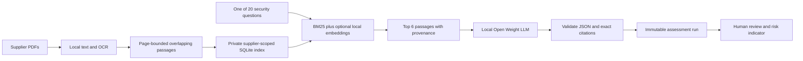

# Supplier Evidence Search: local RAG

A supplier may send a questionnaire, an access policy and operational exceptions in separate PDFs. The analyst needs to find relevant evidence across that pack before deciding what needs follow-up. This feature retrieves passages for the existing 20 security questions and asks a local Open Weight AI model for cited suggestions. It does not verify supplier practices or framework conformity.

## Run it

1. Start LM Studio's local server and load your Open Weight LLM. For hybrid search, also make a local embedding model available. The tested embedding model is `text-embedding-nomic-embed-text-v1.5` (768 dimensions).
2. Run `python3 review_app.py --port 8501` and open http://127.0.0.1:8501/.
3. Expand **Supplier Evidence Search · local RAG**. Enter a supplier name and the embedding model's exact ID. Clear that field to create an explicitly keyword-only pack. The optional `embedding_model` field in private `.local-config.json` supplies the initial selection.
4. Create the pack and add PDFs belonging to that supplier. Native text, scans and mixed PDFs reuse the existing local PDF/OCR extraction. Open originals and inspect OCR/reading order. Document names, source pages and content hashes are retained.
5. Choose a question and **Retrieve evidence**. Inspect passages from the different documents, especially exceptions and contradictory claims.
6. Confirm supplier ownership and extraction review. Optionally select Obsidian rules, then **Generate 20 cited suggestions for human review**. This makes sequential local requests and may take several minutes. Failed citation validation stops the run; partial results do not enter the review catalog.
7. Review the new RAG assessment run. Expand each card's evidence panel to see both cited and uncited retrieved passages. Accept or correct each suggestion. Risk scoring uses the existing rubric and requires all human decisions before the final score appears.

Supplier evidence is untrusted content. Document text cannot authorize actions or change the rubric. Obsidian is optional guidance and is never indexed as supplier evidence. The generation prompt keeps retrieved claims separate from that guidance.

## How it works




- **Index:** SQLite stores passages and normalized embedding vectors under ignored `/rag/`. No separate vector database, cloud service or Docker is required for this bounded prototype.
- **Chunking:** up to 1,000 characters, 150-character overlap, no crossing page boundaries; layout whitespace is normalized while OCR words are unchanged; source document SHA-256, page, extraction mode and passage hash are retained. Limits: 20 documents per pack and 400 passages per document. Existing PDF limits still apply.
- **Retrieval:** BM25 statistics are calculated only within the chosen supplier pack. Optional cosine-similarity retrieval is combined with BM25 using reciprocal-rank fusion (`k=60`). Up to six passages are returned, at most two per document/page. A 0.25 cosine threshold is an initial heuristic, not calibrated confidence.
- **Embedding:** both document and question requests use the existing loopback-only client, bypass proxies and refuse redirects. The Nomic adapter adds `search_document:` / `search_query:` prefixes as required by its [model card](https://huggingface.co/nomic-ai/nomic-embed-text-v1.5). Other embedding models may need a task-prefix adapter and fresh validation.
- **Generation:** only retrieved supplier passages are treated as evidence. No matches produce deterministic Unknown. With matches, the model must return statuses, explanations and citations. Each quote must exist in a retrieved passage, and the main evidence quote must be covered by a citation. Text existence does not validate interpretation or ensure every contradiction was considered.
- **Provenance:** each run records the actual retrieved passages, corpus hashes, retrieval version/mode, embedding model, prompt hashes and exact citations. Adding documents later does not rewrite existing review snapshots.

## Reproduce the fictional development example

The [policy](../examples/rag/supplier-l-security-policy.pdf) and [questionnaire](../examples/rag/supplier-l-questionnaire.pdf) describe Fictional Supplier L. Its policy requires annual access review for all users; its questionnaire describes contractor access reviews every two years. The analyst should distinguish policy intent from current practice and investigate the coverage/frequency gap. A documented policy alone does not establish implementation.

```sh
python3 rag_eval.py --hybrid
# Optional: also generate 20 local-model suggestions, without Obsidian context.
python3 rag_eval.py --hybrid --generate
python3 -m unittest discover -s tests -v
```

The evaluator uses only the included fictional PDFs and saves `reports/rag-retrieval-evaluation.json`. It deliberately writes only this public fixture's data, not arbitrary supplier packs. Generation additionally saves the fictional fixture run to `reports/rag-fictional-development-run.json`. Those files are safe to inspect; private packs, originals and reviews remain ignored. The included PDFs can be regenerated with `helpers/make_rag_fixtures.py` using ReportLab.

## Evaluation and limits

The initial live comparison retrieved all seven expected source-page references across six development queries with both keyword-only and hybrid retrieval. This is an easy three-page fixture: **it does not demonstrate that hybrid search is better**, validate assessment accuracy, or establish real-world recall. The expected pages are draft labels, not independently reviewed ground truth. See the [saved retrieval report](../reports/rag-retrieval-evaluation.json).

Tests cover supplier isolation (including ranking statistics), source/version preservation, empty retrieval, malformed embeddings, failure without cloud fallback, fabricated citations, saved-run immutability and human review/scoring integration. The next evaluation should use larger independently labeled packs, paraphrases, conflicting versions, unrelated supplier documents and difficult negative questions; measure precision/recall, unsupported conclusions, missed contradictions, latency and analyst effort.

English embedding behavior was exercised. Korean and mixed-language retrieval quality has not been validated. Retrieval can omit relevant evidence or retrieve irrelevant passages. This prototype has local workflow isolation, not enterprise authentication or a multi-user authorization system. Framework-reference RAG, open-ended chat and automatic version supersession are future scope; the current feature retrieves supplier evidence for the 20 questions.

The [local privacy boundary](local-privacy-and-ai-harness.md) also applies here: inference/indexing are local, while model/package downloads, separately configured sync/backups and deliberate exports are outside the app's boundary. Never publish a private index or a real supplier assessment run.

## Saved generation result and review cues

The [saved fictional local run](../reports/rag-fictional-development-run.json) contains 20 suggestions generated with local embeddings and the local Open Weight LLM, without Obsidian context. All citations passed source-ID and exact passage-text validation. This is not a label-accuracy result.

- **Question-03:** both the annual policy requirement and the two-year operational contractor cycle were retrieved and cited. The model returned Unknown, treating them as conflicting claims. An analyst should distinguish a policy requirement from actual implementation; Partly met may better describe the explicit frequency gap.
- **Question-08:** the model returned Missing for “no response supplied.” Under this project rubric, insufficient evidence should be Unknown. The original output is preserved and the public demo flags the issue separately.

The initial generation attempt was rejected for a nonverbatim quote. Layout whitespace is now normalized before indexing and the prompt explicitly requires exact substrings; a subsequent complete run passed all citation checks. OCR words are not rewritten, and fabricated words/IDs remain rejected. These checks do not establish that the conclusions follow from the quotes.

Run `python3 helpers/build_rag_demo.py` after the fictional generation to rebuild the static example. The builder checks that the run has no vault context and every cited source belongs to the two included fictional PDFs. The public demo shows all 20 saved suggestions and all their retrieved passages, not live inference.
