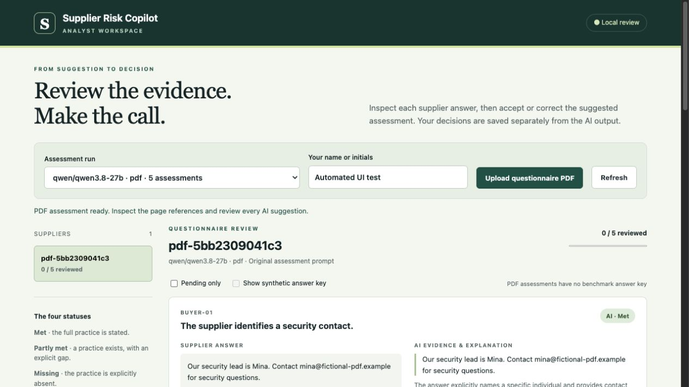

# Local questionnaire PDF intake

Upload a selectable-text, scanned, or mixed PDF in the local analyst screen. Check the extracted answers against the original, map them to the five buyer requirements, then run the local model. This is an analyst upload workflow; there is no supplier portal.

## Start on this Mac

The PDF helper, English/Korean OCR language files and Node OCR runtime are configured on the development Mac. Keep LM Studio's local server running with the configured Qwen model loaded. If the review screen is already running, stop it with Control-C and restart from the project folder:

```sh
python3 review_app.py
```

Open http://127.0.0.1:8501 and choose **Upload questionnaire PDF**.

1. Enter your name or initials. Open the original PDF to inspect the pages.
2. Choose a page and its native text or OCR version. OCR and PDF reading order can be wrong, especially in tables.
3. Copy the answer into its corresponding requirement and enter the source page numbers. You can select text and use **Copy selected answer**. Leave an answer blank when no relevant answer exists.
4. For OCR transcription corrections, record what you corrected after inspecting the original. Corrected answers are explicitly marked in the review evidence.
5. Confirm the answers and page references. Optional Obsidian context uses only the existing allowlisted notes; leave it off for an unchanged-prompt run.
6. Choose **Confirm answers & assess locally**. The app calls LM Studio, validates evidence quotes against the confirmed answers, and opens the results for human review. Accept or correct decisions separately as described in the [review guide](analyst-review.md).

Uploaded questionnaires have no answer key or accuracy score. A matching quote proves that the text occurs in the confirmed answer; it does not prove that OCR was accurate or that the quote supports the model's conclusion.

## Reproduce the PDF setup on another Mac

Requirements: Python 3.10+, macOS with `swiftc` (Apple command-line developer tools), and Node.js 16+ with npm. The assessors and saved-report review use Python's standard library. PDF OCR adds the pinned Node dependency:

```sh
npm install
python3 setup_pdf.py
```

The setup command downloads English and Korean language files once. Extraction then uses local PDFKit, Apple Vision when available, and local Tesseract.js as a fallback. Tesseract receives rendered page images because it does not directly read PDF files; see the [official Tesseract.js documentation](https://github.com/naptha/tesseract.js). No document content is sent to an OCR service. Configure LM Studio using the [local setup guide](local-setup.md); no Google API key is needed for PDF assessments.

## Limits and storage

- Up to 10 MB and 25 pages per PDF; password-protected files must be exported unlocked.
- Confirmed answers are limited to 16,000 characters to keep this prototype within the current model context budget.
- Automatic answer mapping is deliberately absent. Analysts must check page references, reading order, negations, and frequency statements.
- Poor scans, handwriting, complex tables, and Korean layouts need further evaluation. English and Korean OCR languages are configured, but only English fixtures have been verified so far.
- Originals, extracted text, confirmed mappings and immutable assessment runs live in ignored `intake/`. Human decisions and audit events live in ignored `reviews/`. Rendered pages and OCR assets live in ignored `.cache/`. Private config and Obsidian notes stay out of GitHub.
- The server binds to loopback and has no authentication. This is a local portfolio prototype, not a shared production supplier service.

## Verification fixtures

Use `examples/fictional-questionnaire-text.pdf` or `examples/fictional-questionnaire-scan.pdf`. Both contain the same five fictional answers. The image-only version has no selectable text. The rubric statuses are `met`, `partly_met`, `met`, `met`, `unknown`.

Automated checks cover native extraction, scanned extraction, required confirmation, page validation, verbatim mapping checks, explained OCR corrections, malformed input, and integration with the separate reviewer record. A two-page mixed fixture selected native text on page 1 and OCR on page 2. An encrypted fixture was rejected. The browser flow uses an isolated QA data directory and the reviewer name `Automated UI test`; these are test records, not user approvals.

The live scanned-PDF browser test returned the five expected fixture statuses (`met`, `partly_met`, `met`, `met`, `unknown`) and valid quotes. This verifies one synthetic end-to-end example, not general supplier assessment accuracy. All 41 tests passed on the development Mac.


